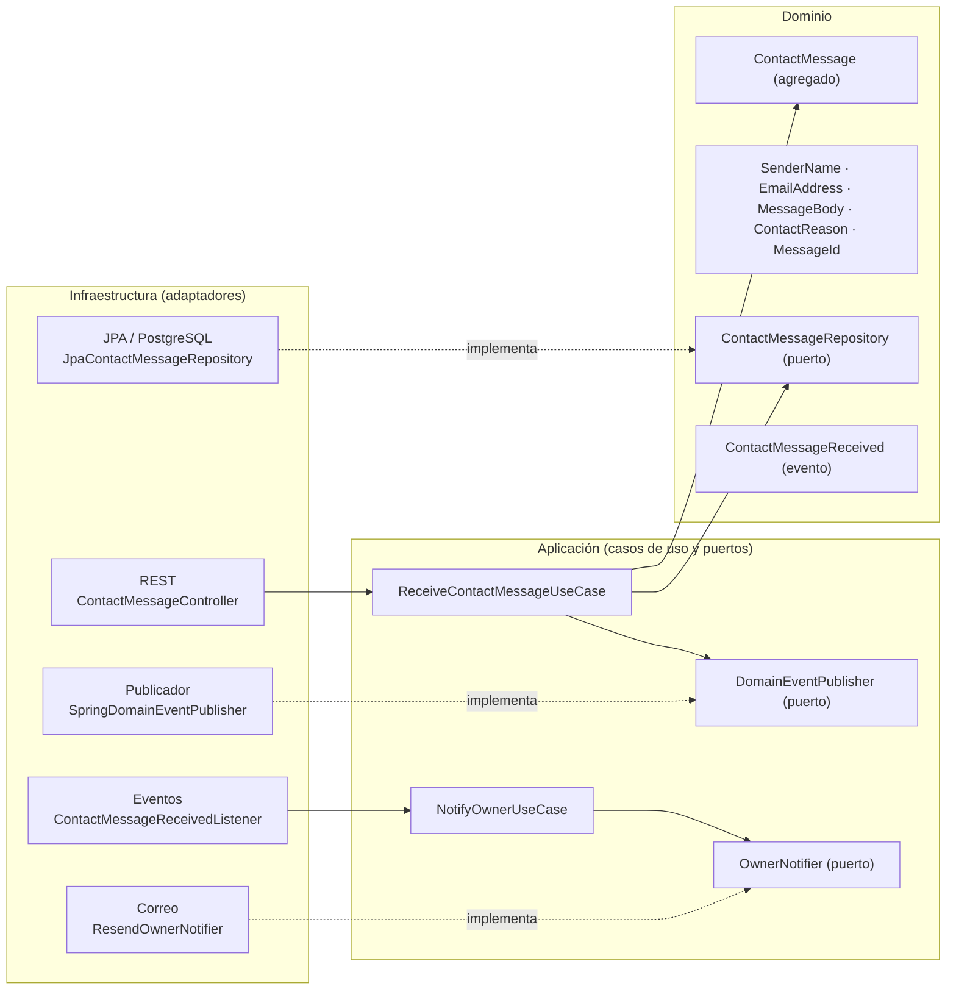
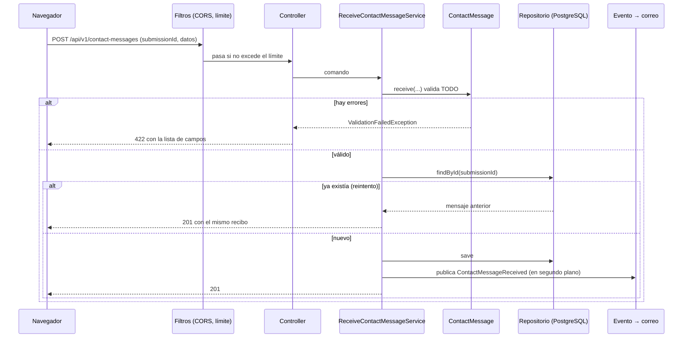

# Arquitectura

## La idea en una frase

El **dominio** (las reglas) no sabe que existen Spring, HTTP ni PostgreSQL. Todo lo demás depende de él, nunca al revés.

## Paquetes (`backend/src/main/java/dev/juanpablocorrea/portfolio/contact`)

| Paquete | Qué contiene | Puede depender de |
|---|---|---|
| `domain.model` | Agregado `ContactMessage` y objetos de valor (se validan solos al crearse) | nada |
| `domain.event`, `domain.error`, `domain.repository` | Eventos, errores de negocio y el puerto del repositorio | nada |
| `application.port.in / out` | Casos de uso que ofrece la app y servicios que necesita | dominio |
| `application.service` | Orquesta los pasos, sin reglas de negocio | dominio, puertos |
| `infrastructure.adapter.in` | REST, filtros (CORS, límite de peticiones, cabeceras) y listener de eventos | aplicación |
| `infrastructure.adapter.out` | PostgreSQL, correo, publicador de eventos | aplicación, dominio |
| `infrastructure.config` | Cableado: único lugar que sabe qué adaptador va en qué puerto | todo |

`ArchitectureTest` (ArchUnit) vigila estas reglas en cada build.

## Qué pasa cuando alguien envía el formulario

## Decisiones (y por qué)

1. **`ContactMessage.receive(...)` es la única forma de crear un mensaje nuevo.** No puede existir uno inválido ni sin autorización.
2. **Todos los errores a la vez.** `Violations` acumula las reglas rotas para que el visitante corrija el formulario de una vez.
3. **Sin `@Transactional` en la capa de aplicación.** Así sigue libre de Spring. `save` ya es transaccional en el adaptador; el evento se publica después de guardar.
4. **Notificación asíncrona y que no puede fallar la petición.** Si el correo falla, el mensaje ya está guardado; solo queda una línea en el log (sin datos personales).
5. **Idempotencia por `submissionId`** en lugar de bloquear el botón: sobrevive a reintentos de red y a servidores que despiertan.
6. **CORS, límite y cabeceras como filtros propios** y no como configuración de MVC: así también cubren las respuestas de otros filtros (por ejemplo un 429).
7. **Límite por visitante y global.** La dirección real se toma de `X-Forwarded-For` contando saltos desde la derecha (`TRUSTED_PROXY_HOPS`), porque lo escrito por el cliente se puede falsificar.
8. **Dependencias mínimas.** El notificador usa `java.net.http`, sin librerías de JSON ni de correo.
9. **Flyway dueño del esquema** (`ddl-auto=none`): la base de datos solo cambia con migraciones versionadas.

## Limitaciones conocidas

- El límite de peticiones vive en memoria: con varias instancias haría falta un almacén compartido (Redis).
- No hay panel de administración: los mensajes llegan por correo y quedan en la tabla `contact_messages`.
- Un correo fallido no se reintenta más allá de 3 intentos; no hay cola (outbox). Para este volumen es suficiente.
